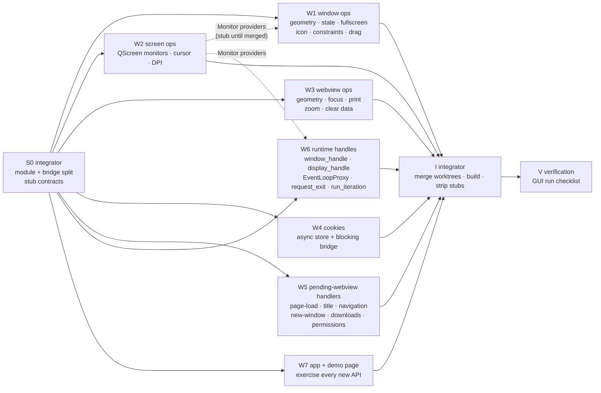

# Parallel work plan — closing the coverage gaps

Goal: implement the missing runtime surface with isolated workers (one git worktree each),
disjoint file ownership, and an integrator who owns the shared files.

## Why this shape

- Rust allows **one** `impl Trait for Type` per type, so `Runtime`/`WindowDispatch`/
  `WebviewDispatch` implementations cannot be split across workers.
- Therefore: the integrator (S0) writes the full delegating impls once, each method calling a
  module function. Workers fill in those module functions (plus their C++ file pair and their
  own bridge file). The stub signatures **are** the contract.
- `build.rs` globs `src/*.cpp` and `src/bridge/*.rs`, so adding files never edits shared paths.

## S0 — integrator refactor (must land before workers start)

1. Move the trait impls out of `src/lib.rs` into `src/runtime_impl.rs` and `src/display_impl.rs`,
   keeping `lib.rs` as glue (`mod` list, statics, creation helpers, `INVOKE_SYSTEM_SCRIPT`).
2. Split the bridge: `src/bridge/{window,webview,screen,cookies,handlers,runtime}.rs`, each its
   own `#[cxx::bridge]` module with its own generated header. Workers own one bridge file each.
3. `build.rs`: glob `src/*.cpp` (sorted) and `src/bridge/*.rs`; no per-file lists.
4. Create the worker module files with the exact signatures and `unimplemented!()`-free stubs:
   every stub returns `Option`/`bool` "unknown" rather than a fabricated value, and the impls map
   "unknown" to `Err(Error::…)` — no lying getters survive S0.
5. Verify `cargo build -p tauriqt` + the M1 smoke still pass, commit.

## Work graph

Dashed edges are interface-only: the providers are stubbed in S0, so no worker ever waits.

## Workers

| Worker | Owns (only these files) | Delivers | Acceptance |
|---|---|---|---|
| W1 | `src/ops/window.rs`, `qt_window.cpp/.hpp`, `src/bridge/window.rs` | real geometry getters, `title`, `is_*` from Qt state, `set_fullscreen`, `minimize/unminimize`, min/max size + constraints, `set_icon`, `set_focus`, `start_dragging`, `start_resize_dragging` | builds; each method either reads Qt or returns `Err` |
| W2 | `src/ops/screen.rs`, `qt_screen.cpp/.hpp`, `src/bridge/screen.rs` | `Monitor` list/primary/from-point (name, size, position, work area, scale), `cursor_position`, `QCursor` set/pos, window scale factor | builds; monitor values match `qscreen` output |
| W3 | `src/ops/webview.rs`, `qt_webview.cpp` (own sections only) | webview geometry getters, `set_size/set_position/set_focus`, `eval_script_with_callback` (runJavaScript callback → Rust), `clear_all_browsing_data`, print/zoom/devtools polish | builds; callback returns a JSON string to Rust |
| W4 | `src/ops/cookies.rs`, `qt_cookies.cpp/.hpp`, `src/bridge/cookies.rs` | `cookies`, `cookies_for_url`, `set_cookie`, `delete_cookie` over `QWebEngineCookieStore` with a blocking bridge (channel + main-thread pump) | builds; round-trip cookie set→get verified in the demo page |
| W5 | `src/ops/handlers.rs`, `qt_handlers.cpp/.hpp`, `src/bridge/handlers.rs` | wire `PendingWebview` handlers tauri installs: `on_page_load_handler`, `document_title_changed_handler`, `navigation_handler`, `new_window_handler`, `download_handler`, `permission_request_handler`; emit `WindowEvent::DragDrop`/`WebviewEvent::DragDrop` | builds; page-load/title events observed in the GUI run |
| W6 | `src/ops/runtime.rs`, `qt_runtime.cpp/.hpp`, `src/bridge/runtime.rs` | `window_handle` + `display_handle` (X11 `QX11Application` / Wayland `QWaylandApplication`), `EventLoopProxy::send_event`, `request_exit`, `run_iteration` | builds; proxy event reaches the run callback |
| W7 | `tauriqt/`, `dist/`, `PLAN.md`, `RUNTIME-TRAITS.md` | demo page exercising every new API + doc updates written from the merged result | builds; page shows one line per API |

## Rules given to every worker

1. `isolated: true` — work in your own worktree, commit there, never touch another worker's files.
2. Owned files only; if you need a change in `lib.rs`, `runtime_impl.rs`, `build.rs`,
   `Cargo.toml` or another worker's bridge file, report the exact change instead of making it.
3. Do not run `cargo` more than once, at the end of your work (one build + optional run).
4. Keep `unimplemented!()`/fabricated values out: unknown state is `Err(Error::…)`, never a guess.
5. Report: files, exact Qt APIs used, what you verified, what you could not.

## Integration (I do this)

1. Apply all worktrees, resolve the (expected: zero) overlaps on shared files.
2. One build; fix integration errors centrally rather than sending workers back.
3. Run the GUI checklist: window geometry/state, monitors, cookies, page-load/title events,
   proxy event, `invoke()` still green, `asset://` fetch, devtools open/close, print dialog.
4. Strip any remaining stubs that return fabricated values; update docs; commit.

## Risks

- **Qt/Wayland semantics**: absolute positioning, `always_on_top`, `skip_taskbar` are not
  expressible on Wayland — W1 must return `Err` there, not fake success.
- **Cookies**: `QWebEngineCookieStore` is callback-only; blocking on the GUI thread deadlocks if
  the callback needs the GUI thread — W4 must pump a nested `QEventLoop` with a timeout.
- **Handler wiring (W5)** touches tauri's semantics (navigation deny, new-window allow) — a wrong
  default silently breaks links; W5 must default to "allow" and match wry's behaviour.
- **EventLoopProxy (W6)**: must be safe from any thread; queue + `invokeMethod(QueuedConnection)`.
- **Bridge growth**: 6 bridge files mean 6 generated headers; build.rs globbing keeps this free,
  but each worker must include only its own header in C++.
